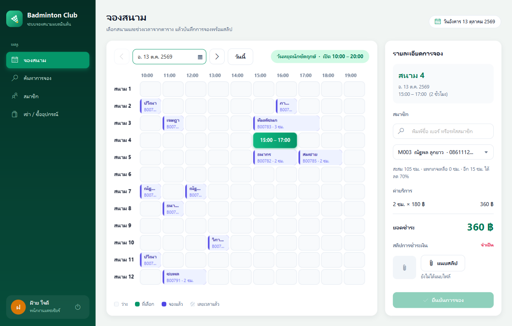

# 🏸 Badminton Club — ระบบจองสนามแบดมินตัน

Java 21 · JavaFX 21 · Maven · ไม่ใช้ฐานข้อมูลภายนอก (บันทึกลงไฟล์ `data/club.dat`)



## วิธีรัน

- **ง่ายสุด**: ดับเบิลคลิก **`run.bat`** (ต้องมี JDK 21+ ดูวิธีติดตั้งใน [คู่มือการลงติดตั้ง.md](คู่มือการลงติดตั้ง.md))
- **IntelliJ**: เปิดโปรเจกต์ → รัน `Launcher` (หรือ Maven → `javafx:run`)
- **Command line**: `mvnw javafx:run`
- **ทดสอบ**: `mvnw test` (เทสต์กฎธุรกิจ 10 ข้อใน `ClubTest`)

| เอกสาร | ไว้ทำอะไร |
|---|---|
| [คู่มือการลงติดตั้ง.md](คู่มือการลงติดตั้ง.md) | ติดตั้งบนเครื่องเพื่อน + เช็กลิสต์ก่อนพรีเซ็นต์ |
| [HANDOVER.md](HANDOVER.md) | สถานะล่าสุดและงานถัดไป (สำหรับคน/AI ที่มาทำต่อ) |
| [skills.md](skills.md) | วิธีทำงานกับโค้ดนี้ สไตล์ และกับดักที่เคยเจอ |
| [docs/IMAGE-CREDITS.md](docs/IMAGE-CREDITS.md) | ที่มาและลิขสิทธิ์ของภาพสินค้า |
| [docs/สคริปต์นำเสนอ.md](docs/สคริปต์นำเสนอ.md) | สคริปต์พูด 10 นาที + ลำดับสาธิต + เตรียมตอบคำถาม |
| `docs/Badminton-Club-Presentation.pptx` | สไลด์ 12 หน้า มีโน้ตผู้พูด |
| `docs/Badminton-Club-Video.mp4` | คลิปโชว์แอป 72 วินาที มีเสียงพากย์ AI ภาษาไทย (ซอร์ส HyperFrames ใน `video/`) |

บัญชีทดลอง: `cashier / 1234` (แคชเชียร์ **Jack**) · `admin / 1234` (ผู้ดูแลระบบ **นุ**). ที่หน้าเข้าสู่ระบบมีปุ่มกดกรอกให้

ครั้งแรกที่เปิดโปรแกรมจะสร้างข้อมูลตัวอย่างย้อนหลัง 3 เดือนให้ (กราฟจะได้มีข้อมูลตอนพรีเซ็นต์)
ถ้าอยากเริ่มใหม่ ให้ **ลบโฟลเดอร์ `data`** แล้วเปิดโปรแกรมใหม่ — ควรลบก่อนวันพรีเซ็นต์ เพื่อให้ข้อมูล "วันนี้" ตรงกับวันจริง

## โครงสร้างโปรเจกต์

```
com.example.badmintonbookingsystem
├── App, Launcher            จุดเริ่มโปรแกรม
├── model/                   ข้อมูล + กฎธุรกิจ (ไม่มีโค้ดหน้าจอเลย)
│   ├── Billable             «interface» อะไรก็ตามที่ทำให้มีรายได้
│   ├── User                 «abstract» → Cashier, Admin
│   ├── Member, Booking, Quote, PackagePurchase, ShopSale
│   ├── Product, Menu, RevenueType   (enum)
│   └── ClubRules            กฎทุกข้อรวมไว้ที่เดียว: ราคา เวลาเปิด-ปิด ส่วนลด
├── service/
│   ├── Club                 เก็บข้อมูล + ตรวจกฎก่อนบันทึกทุกครั้ง + บันทึกไฟล์
│   └── DemoData             ข้อมูลตัวอย่าง
└── ui/                      หน้าจอ JavaFX
    ├── Page                 «abstract» หน้าจอ 1 หน้า → BookingPage, SearchPage, MemberPage, ShopPage, RevenuePage, HistoryPage
    ├── LoginView, MainView, BookingTable
    └── Ui                   ชิ้นส่วนที่ใช้ซ้ำ (การ์ด ปุ่ม ตาราง แจ้งเตือน)
```

แผนภาพอยู่ใน `docs/diagrams/` (ไฟล์ `.puml` คือต้นฉบับ แก้แล้วสร้าง PNG ใหม่ได้ด้วย PlantUML) และภาพหน้าจออยู่ใน `docs/screenshots/`

| แผนภาพ | ใช้อธิบาย |
|---|---|
| `class-diagram.png` | คลาสหลัก (model + service): interface, abstract class, ความสัมพันธ์ |
| `class-diagram-ui.png` | ชั้นหน้าจอ: Page ที่สืบทอดกัน และ MainView |
| `use-case.png` | ใครทำอะไรได้ (แคชเชียร์ / ผู้ดูแลระบบ) |
| `sequence-booking.png` | ลำดับการทำงานตอนกด "ยืนยันการจอง" |
| `activity-pricing.png` | ขั้นตอนคิดราคา (แพกเกจ, ชั่วโมงที่ 20 ลด 70%) |

## ตรวจตามโจทย์ทีละข้อ

| โจทย์ | ทำที่ไหน |
|---|---|
| 12 สนาม 180 บาท/ชม. | `ClubRules.COURTS`, `HOURLY_RATE` |
| วันธรรมดา 13–21 น. / ส.-อา. และวันหยุดนักขัตฤกษ์ 10–20 น. | `ClubRules.openHour/closeHour/isHoliday` |
| ต้องเป็นสมาชิกจึงจองได้ | `Club.book` ปฏิเสธถ้าไม่ได้เลือกสมาชิก |
| ผู้ใช้คือแคชเชียร์และผู้ดูแล | `Cashier`, `Admin` สืบทอดจาก `User` |
| ระบุสนาม วัน เวลา และแนบสลิป | หน้า `BookingPage` (สลิปถูกคัดลอกไปไว้ใน `data/slips`) |
| แพกเกจ 15 ชม. 2,600 บาท | หน้าสมาชิก → `Club.buyPackage` |
| จองครบ 19 ชม. ชั่วโมงที่ 20 คิด 30% | `ClubRules.quote` (ทุกชั่วโมงที่ 20, 40, 60, …) |
| เช่ารองเท้า/ไม้ 50 บาท/ครั้ง/วัน | `Product.SHOES_RENTAL`, `RACKET_RENTAL` |
| ซื้ออุปกรณ์ (กำหนดราคาเอง) | ลูกขนไก่ 80 · เทปพันด้าม 60 · ไม้แบด 1,290 บาท (มีภาพสินค้าในหน้าร้าน) |
| แคชเชียร์ค้นหาการจอง | `SearchPage` → `Club.search` |
| ผู้ดูแลดูประวัติสมาชิก | `HistoryPage` → `Club.historyOf` |
| ผู้ดูแลดูสรุปรายได้รายวัน/รายเดือน | `RevenuePage` → `Club.revenue` |
| ใช้ interface / abstract class | `Billable` (interface), `User` และ `Page` (abstract) |

## จุดเด่นด้าน OOP (ไว้พูดตอนพรีเซ็นต์)

1. **Interface `Billable`**: การจอง แพกเกจ และร้านค้าเป็นคนละคลาสกัน แต่ทุกคลาสบอก `paidOn()`, `type()` และ `amount()` ได้เหมือนกัน
   `Club.revenue()` จึงรวมรายได้ทั้งหมดได้ในลูปเดียว ถ้าวันหน้ามีรายได้ประเภทใหม่ ก็แค่ให้คลาสนั้น implement `Billable` โดยไม่ต้องแก้รายงาน
2. **Abstract class `User`**: แต่ละบทบาทบอกเองว่าใช้เมนูอะไรได้ (`menus()`) หน้าหลักจึงสร้างเมนูจาก `user.menus()`
   โดยไม่มี `if (role == ...)` เลย นี่คือ **polymorphism**
3. **Abstract class `Page`**: ทุกหน้าต้องมี `refresh()` เมื่อสลับหน้า `MainView` จะเรียก `page.refresh()` ได้โดยไม่ต้องรู้ว่าเป็นหน้าไหน
4. **Encapsulation**: สมาชิกถูกตัดชั่วโมงผ่าน `member.charge(quote)` เท่านั้น ส่วนการจองต้องผ่าน `Club.book()` ซึ่งตรวจกฎทุกข้อก่อนบันทึก
5. **Separation of concerns**: `model` ไม่ import JavaFX เลย จึงเขียนเทสต์กฎธุรกิจได้โดยไม่ต้องเปิดหน้าจอ
6. **Record** (`Booking`, `Quote`, …) ใช้กับข้อมูลที่ไม่เปลี่ยนหลังบันทึก ทำให้โค้ดสั้นและเปลี่ยนค่าผิดพลาดไม่ได้

## ข้อจำกัดที่ควรรู้

- วันหยุดตามจันทรคติและวันหยุดชดเชยใส่ไว้ถึงปี 2569 (`ClubRules.YEARLY_HOLIDAYS`) ขึ้นปีใหม่ต้องเพิ่มตามประกาศ ครม.
- รหัสผ่านเก็บแบบข้อความธรรมดา เพราะเป็นงานสาธิต ถ้าใช้งานจริงควร hash
- ถ้าแก้โครงสร้างคลาสใน `model` ไฟล์ `data/club.dat` เดิมจะอ่านไม่ได้ โปรแกรมจะย้ายไฟล์เดิมไปสำรองเป็น `club.dat.broken-…` แล้วเริ่มใหม่ด้วยข้อมูลตัวอย่าง
